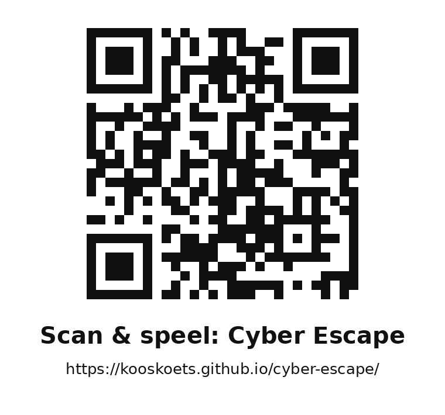

# 🕵️ Cyber Escape: Het Gehackte Huis

Een 3D-escape room in de browser waarin vmbo-leerlingen (12–16 jaar) spelenderwijs leren over cybersecurity.

**▶ Speel de game:** https://kooskoets.github.io/cyber-escape/

## Het verhaal

Sam is even naar de supermarkt voor chips. Jij past op het huis. Wat kan er misgaan? Nou... alles.
**Hacker Kraai** heeft het slimme huis overgenomen en de voordeur op slot gezet. Los bij elk apparaat de vragen op. Wie **minstens de helft goed** heeft, krijgt een cijfer. Vind alle 6 cijfers van de deurcode en ontsnap op tijd.

## Onderwerpen

| Apparaat | Kamer | Onderwerp |
|---|---|---|
| 💻 Laptop | Slaapkamer | Phishing & nepberichten (mail, WhatsApp-fraude) |
| 🎮 Gameconsole | Woonkamer | Sterke wachtwoorden, wachtwoordmanager & 2FA |
| 📱 Telefoon | Keuken | Social engineering & privacy op social media |
| 🖥️ Computer | Woonkamer | Malware, updates, USB-sticks, open wifi & ransomware |
| 📷 Slimme camera | Werkkamer | Slimme apparaten (IoT): standaardwachtwoorden, updates, gastnetwerk |
| 📲 Tablet | Gameroom | AI, deepfakes, stem-nabootsing & nepnieuws |
| ⭐ Bonus | Overal | 5 verborgen risico's in huis |

## Voor de docent

- **Speelduur:** kies op het startscherm 30, 40 (standaard) of 50 minuten.
- **Spelregel:** heeft een leerling bij een station **meer dan de helft fout**, dan is er geen cijfer. Hij doet het station opnieuw, met andere vragen.
- **Vragen:** elk station trekt willekeurige vragen uit een grotere pot (in totaal 57 vragen) en de antwoorden staan elke keer in een andere volgorde. Leerlingen kunnen dus niet van elkaar afkijken.
- **Apparaten:** laptop/Chromebook (toetsenbord + muis) en telefoon/tablet (aanraakbediening, liggend spelen).
- **Resultaten:** het eindscherm toont naam, datum, score, het resultaat per onderwerp en een lijst "Hier kun je nog van leren". Laat leerlingen hiervan een screenshot maken. Er wordt **niets opgeslagen of verstuurd**.
- **Geluid:** de muziek en de effecten zijn los harder of zachter te zetten. Je kiest uit 4 muziekjes of de stand "Wisselen", en uit verschillende voetstapgeluiden (of uit). De toets `M` zet het geluid aan of uit. Oortjes zijn aan te raden.
- **Spieken lukt niet:** de deurcode is bij elk spel anders.
- **Offline spelen:** `index.html` is één bestand met alles erin. Je kunt het op een USB-stick zetten en met een dubbelklik openen.

### Tips voor de nabespreking

1. Welke phishing-signalen zag je? (vreemd afzenderadres, haast, dreigen, te mooi om waar te zijn)
2. Waarom is `pizza-fiets-wolk-oranje` sterker dan `P@ssw0rd`?
3. Wat deelde Sam online dat hij beter niet had kunnen delen?
4. In de game leer je dat je geen onbekende USB-stick insteekt. Waarom mocht dat bij deze game wél? (Die stick kwam van een bekende afzender.)
5. Hoe herken je een deepfake of een nagedane stem? Wat doe je als "mama" belt en geld vraagt?
6. Waarom moet je het standaardwachtwoord van een slimme camera meteen veranderen?
7. **Gouden regel:** twijfel je? Klik niet, en check het via een andere manier.

## Techniek

- Eén HTML-bestand, zonder installatie of server-code.
- 3D: [three.js](https://threejs.org) r128 (MIT-licentie), in het bestand ingebouwd.
- Lettertypen: Press Start 2P en Nunito (SIL Open Font License), in het bestand ingebouwd.
- De muziek en geluiden worden in de browser gemaakt met de Web Audio API. Er zitten geen audiobestanden in.
- Alle figuren, merken en personen in de game zijn verzonnen.
